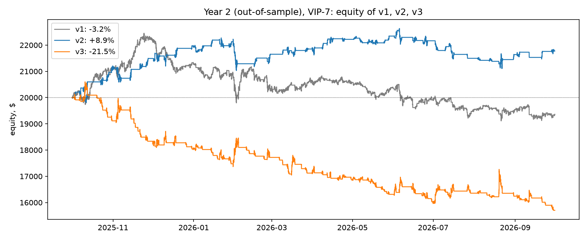
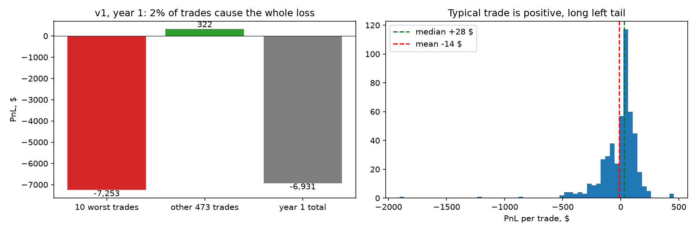
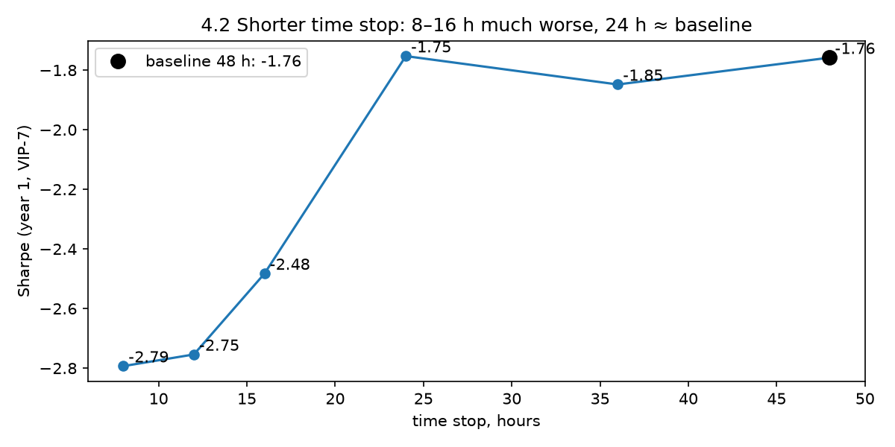
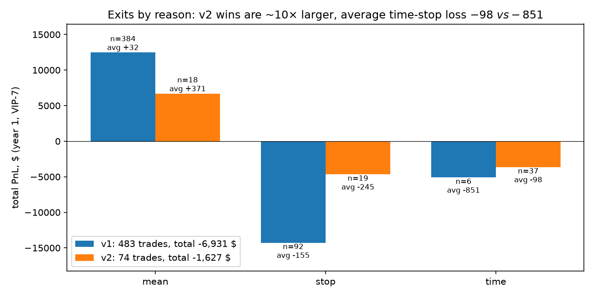
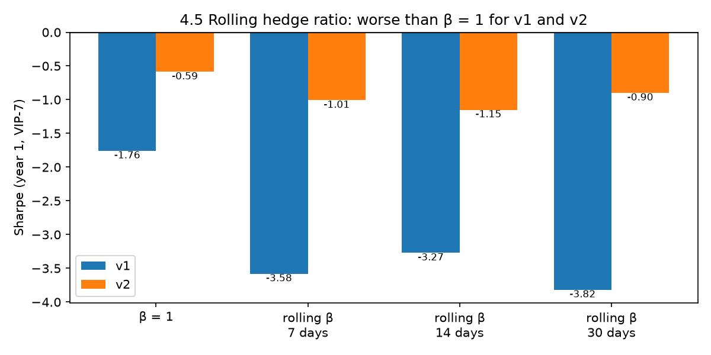
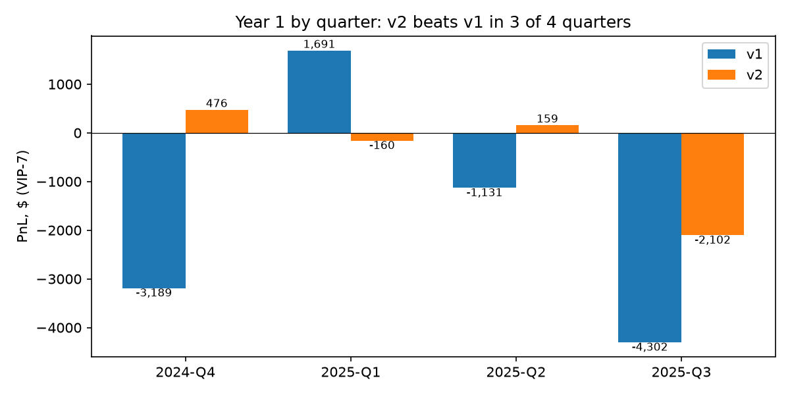
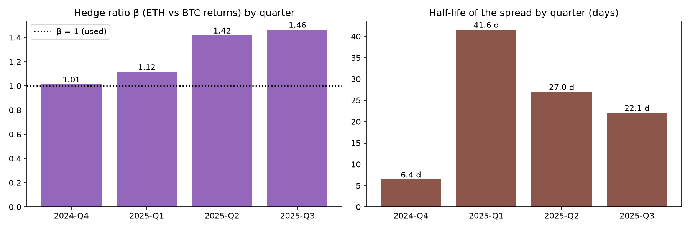

# ETH/BTC Pairs Trading — Backtest (Binance USDⓈ-M perpetuals)

Statistical-arbitrage strategies on the ETH/BTC spread, built and backtested from scratch on 5-minute bars (October 2024 – September 2026) with realistic costs: taker fees, slippage and funding. Two opposite ideas were tested on the same spread: **mean reversion** (v1, v2) and **trend-following** (v3).

**How the data was used**

| Period | Dates | Used for |
|--------|-------|----------|
| **Year 1** | Oct 2024 – Sep 2025 (105,120 bars) | all research and every parameter choice |
| **Year 2** | Oct 2025 – Sep 2026 (105,120 bars) | held out, used **once** per strategy for the final test |

---

## 1. Summary

| Version | What it is | Year 1 (research), VIP-7 | **Year 2 (test), VIP-7** | **Year 2 (test), Regular** |
|---------|------------|--------------------------|--------------------------|----------------------------|
| **v1** | mean reversion, 1-day z-window, entry \|z\| > 2 | −34.7%, Sharpe −1.76 | −3.2%, Sharpe −0.28 | −31.4%, Sharpe −3.30 |
| **v2** | mean reversion, 7-day z-window, entry \|z\| > 2.5 | −8.1%, Sharpe −0.59 | **+8.9%, Sharpe +1.08** | **+4.9%, Sharpe +0.61** |
| **v3** | trend-following, 7-day z-window, entry \|z\| > 2, exit at \|z\| = 1 | **+24.3%, Sharpe +1.50** | −21.5%, Sharpe −1.97 | −27.4%, Sharpe −2.48 |

- **v1 loses money** at every fee tier, in both years.
- **v2** (chosen on year 1 only, fixed by commit before the test) is **profitable on year 2** at every tier with a max drawdown of about −7%, but it lost money on year 1 and is roughly flat over the two years.
- **v3** (chosen on year 1 only, fixed by commit before the test) looked strong on year 1 — all 12 grid cells positive — but **failed on year 2** (−21.5% … −27.4%, negative in all four quarters).
- **Main finding:** the ETH/BTC spread has **no stable regime**. Year 1 was trending (v3 won, v2 lost), year 2 was mean-reverting (v2 won, v3 lost). Each strategy works only in "its" year, and a z-score alone cannot tell which regime the market is in. Neither version has a proven edge over both years.
- **The process worked:** v3's year-1 result rested on two trades (93% of its profit); this was recorded before the test, and the one-time test exposed it.




---

## 2. Strategy

Legs: **A = ETHUSDT**, **B = BTCUSDT** (Binance USDⓈ-M perpetual futures).

### 2.1 Common parts (all versions)

1. **Spread:** `s = ln(ETH) − β · ln(BTC)`, β = 1. The spread rises when ETH outperforms BTC.
2. **Z-score:** `z = (s − rolling mean) / rolling std` over the last `window` bars. The window includes the current bar and only looks backwards.
3. **Size:** $10,000 notional per leg, fixed. Starting capital $20,000. Dollar-neutral (not β-neutral).
4. **Execution:** one position at a time; decisions on the bar close, execution at the **next bar's open**; no trade on bars where either leg had no trades; a position still open at the end of the data is closed at the last close (reason `end`).
5. **Pause:** after a stop or time-stop exit, no new entry until |z| < entry_z.

### 2.2 Mean reversion (v1, v2)

- **Entry:** `z > entry_z` → **short the spread** (short ETH, long BTC); `z < −entry_z` → **long the spread** (long ETH, short BTC).
- **Exit (mean):** close when z crosses back to 0.
- **Stop:** close when |z| > 4.
- **Time stop:** close after 576 bars (2 days).

**Example trade.** z = 2.4 with ETH = 2,500 and BTC = 62,500 → short 4 ETH, long 0.16 BTC. Five hours later ETH = 2,475, BTC unchanged, z back to 0 → exit. ETH leg +$100, BTC leg $0, fees (VIP-7) −$12.80 → **+$87.20**.

### 2.3 Trend-following (v3)

Same spread and z-score, **opposite bet**: a large |z| is treated as the start of a trend, not as a dislocation.

- **Entry:** `z > entry_z` → **long the spread** (long ETH, short BTC); `z < −entry_z` → **short the spread**.
- **Exit (fade):** close when the move has faded: long → `z ≤ exit_z`; short → `z ≥ −exit_z` (reason `fade`).
- **No z-stop:** in a trend a growing |z| is the goal.
- **Time stop:** 4032 bars (14 days).

**Example trade (unit test, Regular fees).** z rises to 2.5 with ETH = 2,500, BTC = 62,500 → long 4 ETH, short 0.16 BTC. ETH rises to 2,600, z falls to 0.4 (below exit 0.5) → exit at 2,600. ETH leg +$400, BTC leg $0, fees −$24.24 → **+$375.76**.

| Parameter | v1 | v2 | v3 |
|-----------|----|----|----|
| direction | against the move | against the move | with the move |
| `window` | 288 bars (1 day) | 2016 bars (7 days) | 2016 bars (7 days) |
| `entry_z` | 2.0 | 2.5 | 2.0 |
| exit | z crosses 0 | z crosses 0 | \|z\| back to 1.0 |
| z-stop | \|z\| > 4 | \|z\| > 4 | none |
| time stop | 2 days | 2 days | 14 days |

**v1 has no regime filter.** It enters on |z| > 2 even while the spread is trending. In a steady trend the rolling mean and std follow the spread, so z stays around 2 (for a perfectly linear trend z ≈ √3 ≈ 1.7 regardless of its speed) and the z-stop (|z| > 4) never fires; the trade is closed only by the 2-day time stop. This produced v1's largest losses and is why a regime filter was planned. An entry filter was tested (4.4) and rejected; the longer z-window of v2 addressed the problem better, and v3 tried to trade the trends directly.

---

## 3. Data, costs and accounting

**Data**
- Binance public data (`data.binance.vision`): USDⓈ-M futures, monthly 1-minute klines and funding-rate files, 2024-10 … 2026-09.
- 1-minute bars → 5-minute bars (open/high/low use only minutes with trades); ETH and BTC aligned on `open_time`. 210,240 bars in total.
- Funding times in the files carry +1 ms; they are rounded to the nearest 5-minute bar.

**Costs** — every fill is a taker fill plus 1 bp slippage; 4 fills per round trip.

| Tier | Taker fee | + slippage | Cost per fill | Cost per round trip ($10k legs) |
|------|-----------|------------|---------------|---------------------------------|
| Regular | 5.0 bp | 1 bp | 6.0 bp | $24.00 |
| VIP-4 | 3.0 bp | 1 bp | 4.0 bp | $16.00 |
| VIP-7 | 2.2 bp | 1 bp | 3.2 bp | $12.80 |

**Funding** — every 8 hours, at the start of the funding bar and before that bar's planned trade, at the bar's open price: `payment = qty × price × rate` (longs pay when the rate is positive). Funding never affects decisions (verified by a test). Because the two legs are opposite, payments largely cancel: effect on v1 over two years was +$182 (< 1%).

**Accounting** — `cash −= qty_a·price_a + qty_b·price_b + fees` (signs handle long/short); `equity = cash + qty_a·close_a + qty_b·close_b`.

**Metrics** — total return; max drawdown; Sharpe = mean / std (ddof = 1) of daily returns × √365 (risk-free = 0); win rate; average trade; profit factor (gross wins / gross losses); exposure (share of bars in a position). Sharpe is reported as NaN if equity ever falls to zero or below.

---

## 4. How the backtest was checked

| Check | How | Result |
|-------|-----|--------|
| Money is counted correctly | 6-bar example with every dollar calculated by hand (equity on each bar, fees, PnL 176.12) | exact match |
| Stops and new rules | hand-calculated cases: loss stop (PnL −264.144), β-sized BTC leg (0.24 BTC, PnL 50.192), early exit (PnL 56.048) | exact match |
| Trend mode (v3) | hand case: long 4 ETH / short 0.16 BTC, `fade` exit, PnL 375.76; a case where mean reversion hits the z-stop but trend mode does not | exact match |
| New options do not change old results | every new option switched off (`trend=False`, `exit_z=0`, β = 1, no loss stop) gives exactly v1 | identical |
| Fast engine = reference engine | numba engine vs Python engine on hand cases and 5,000 random bars with funding | identical trades, equity and positions; numba 46× faster |
| No look-ahead | z-score test: a centred window (which looks into the future) must fail the test | passes only with the backward window |
| Funding does not change decisions | same trades with and without funding | identical |
| Year-1 baseline after every change | v1 re-run on year 1 after each code change | always −34.7%, Sharpe −1.76 |
| Bankrupt runs | a test where equity dips below zero between daily samples | Sharpe = NaN, `min_equity` shows it |
| Notebooks agree | final-test notebooks (06, 09) re-run year 1 and match the research notebooks (05, 08); v1/v2 year-2 results in 09 match 06; quarterly sums match yearly totals | identical |

**45 tests** in `tests/` (`pytest -v`).

**A bug found and fixed during research:** one grid cell (12-hour window, entry 1.5) showed Sharpe **+0.99** while its return was **−107%** — equity had gone below zero, and daily returns (change ÷ yesterday's equity) became meaningless. Since then Sharpe is NaN for any run whose equity touches zero, and every table shows `min_equity`.

---

## 5. Research on year 1 — mean reversion (v1 → v2)

Rules used throughout:
- **one change at a time**, compared with the year-1 baseline;
- every run logged in `reports/research_log_year1.csv` (~150 variants) — notebook `05_research_year1.ipynb`;
- a change is accepted only if it improves **a region of neighbouring settings (a plateau)**, at both VIP-7 and Regular — not a single lucky point;
- year 2 is not touched.

All numbers in this section: **year 1, VIP-7** unless stated.

### Step 0 — v1 baseline: where the money is lost

| | Trades | Win rate | Avg trade | Profit factor | Return | Max DD | Sharpe |
|-|--------|----------|-----------|---------------|--------|--------|--------|
| VIP-7 | 483 | 61.7% | −$14.35 | 0.768 | −34.7% | −37.2% | −1.76 |
| Regular | 483 | 58.2% | −$25.56 | 0.614 | −61.7% | −63.1% | −3.17 |

Exits by reason (VIP-7):

| Exit | Trades | Avg PnL | Total PnL | Avg holding |
|------|--------|---------|-----------|-------------|
| mean | 384 | +$32 | +$12,467 | 11 h |
| stop | 92 | −$155 | −$14,269 | 4 h |
| time | 6 | **−$851** | −$5,108 | 48 h |
| end | 1 | −$21 | −$21 | — |

The 10 worst trades:

| Month | Exit | PnL | z_long at entry | Deviation at entry |
|-------|------|-----|-----------------|--------------------|
| May 2025 | time | −$1,906 | 0.97 | 200 bp |
| Jul 2025 | time | −$1,219 | 0.92 | 119 bp |
| Aug 2025 | time | −$851 | 0.74 | 93 bp |
| Feb 2025 | stop | −$505 | −2.89 | 478 bp |
| Aug 2025 | time | −$491 | −0.92 | 177 bp |
| Jan 2025 | stop | −$468 | −0.96 | 115 bp |
| Aug 2025 | mean | −$465 | 1.35 | 196 bp |
| Dec 2024 | stop | −$464 | 0.24 | 116 bp |
| Nov 2024 | mean | −$450 | 1.31 | 119 bp |
| Sep 2025 | time | −$433 | −0.23 | 123 bp |

**Key finding:** the 10 worst trades (2% of trades) lost **−$7,253**, more than the whole year (**−$6,931**). The typical trade is profitable.



### 4.1 Stop by dollar loss per trade — rejected

**Idea:** the z-stop misses trends, so also stop on money: exit when the open trade is down more than a threshold (exit at the next open, reason `loss`, then pause). Two ways to set the threshold:
- **% of the $10k leg** (a fixed dollar amount: 2% = $200 ≈ the spread moved 2% against us);
- **% of equity at entry** (stricter as equity falls).

| Variant | Trades | Win rate | Avg trade | PF | Return | Max DD | Sharpe |
|---------|--------|----------|-----------|----|--------|--------|--------|
| **baseline** | 483 | 61.7% | −14.35 | 0.768 | **−34.7%** | −37.2% | **−1.76** |
| 1% of leg ($100) | 641 | 51.3% | −10.65 | 0.811 | −34.1% | −35.8% | −2.01 |
| 1.5% of leg | 579 | 57.2% | −13.05 | 0.787 | −37.8% | −39.2% | −2.19 |
| 2% of leg | 546 | 59.9% | −14.55 | 0.771 | −39.7% | −42.4% | −2.18 |
| 3% of leg | 516 | 60.9% | −17.87 | 0.731 | −46.1% | −48.5% | −2.42 |
| 5% of leg ($500) | 496 | 61.5% | −15.38 | 0.758 | −38.1% | −40.7% | −1.96 |
| 0.5% of equity | 714 | 43.1% | −13.64 | 0.746 | −48.7% | −49.8% | −3.03 |
| 0.75% of equity | 616 | 53.4% | −12.34 | 0.792 | −38.0% | −39.7% | −2.10 |
| 1% of equity | 574 | 58.2% | −13.42 | 0.782 | −38.5% | −40.8% | −2.23 |
| 1.5% of equity | 536 | 60.8% | −15.31 | 0.763 | −41.0% | −43.5% | −2.17 |
| 2.5% of equity | 498 | 61.4% | −14.72 | 0.765 | −36.7% | −39.3% | −1.92 |

Regular: every variant checked was worse than baseline (−69% … −78% vs −61.7%).

**Why it fails:** many trades temporarily lose $100–500 and then revert to the mean with a profit; the stop turns those into real losses (win rate drops to 43–61%) and adds trades and fees (1% of leg: +158 trades ≈ −$2,000 in fees). **Sharpe is worse in all 10 variants → rejected** (code kept, off by default).


### 4.4 Regime filter at entry — rejected (diagnosis only, engine unchanged)

**Question:** can a bad trade be recognised **at the moment of entry**?

*Feature 1 — weekly z (`z_long`, 7-day window).* Hypothesis: large |z_long| = the spread has trended all week = bad trade. The data said the opposite:

| \|z_long\| at entry | Trades | Avg PnL | Total |
|---------------------|--------|---------|-------|
| ≤ 1 | 236 | −25.6 | −6,051 |
| 1 – 1.5 | 111 | −17.9 | −1,989 |
| 1.5 – 2 | 64 | +13.3 | +848 |
| 2 – 2.5 | 33 | −18.5 | −610 |
| 2.5 – 3 | 17 | +3.6 | +62 |
| > 3 | 13 | +79.0 | +1,027 |

*Feature 2 — deviation of the spread from its mean, in bp* (≈ the dollar profit if it fully reverts). Five equal groups (~95 trades each):

| Deviation | Avg PnL | Median PnL | Win rate | Total |
|-----------|---------|------------|----------|-------|
| 48 bp | −14.3 | +24.3 | 68% | −1,358 |
| 75 bp | +0.9 | +29.7 | 64% | +86 |
| 103 bp | −52.7 | +20.6 | 53% | −4,957 |
| 147 bp | −14.7 | +41.4 | 59% | −1,399 |
| 278 bp | +9.6 | +68.2 | 63% | +915 |

- No consistent link between either feature and PnL; even the smallest deviation (48 bp) is 4× the VIP-7 cost, so costs are not the issue.
- **The median trade is profitable in every group** (+$20 … +$68). Group averages are driven by a few huge losers.
- The 10 worst trades had ordinary z_long and deviation at entry (see the table in Step 0): **the trend starts after entry**, so no entry filter on these features can separate them. **Rejected.**

### 4.2 Shorter time stop — rejected

| Time stop | Trades | Win rate | PF | Return | Max DD | Sharpe |
|-----------|--------|----------|----|--------|--------|--------|
| 8 h | 593 | 49.9% | 0.721 | −45.1% | −46.9% | −2.79 |
| 12 h | 544 | 53.9% | 0.712 | −48.4% | −50.2% | −2.75 |
| 16 h | 520 | 58.1% | 0.731 | −44.0% | −45.8% | −2.48 |
| 24 h | 501 | 61.1% | 0.783 | −32.6% | −35.7% | −1.75 |
| 36 h | 487 | 61.2% | 0.760 | −36.2% | −38.8% | −1.85 |
| **48 h (baseline)** | 483 | 61.7% | 0.768 | −34.7% | −37.2% | −1.76 |

Many good trades need 16–24 h to revert; cutting earlier destroys them. 24 h is ≈ baseline with worse neighbours → noise. **Rejected.**



### 4.3 Grid: z-window × entry threshold — **accepted → v2**

Instead of changing exits around the signal, change the signal itself: 7 windows (12 h … 14 days) × 4 entry thresholds.

Sharpe, VIP-7:

| window | 1.5 | 2.0 | 2.5 | 3.0 |
|--------|-----|-----|-----|-----|
| 144 (12 h) | bankrupt | −2.90 | −3.48 | −3.86 |
| 288 (1 d, v1) | −2.33 | **−1.76** | −1.53 | −2.35 |
| 576 (2 d) | −2.34 | −2.37 | −2.31 | −2.43 |
| 1152 (4 d) | −0.94 | −1.12 | −0.78 | −1.27 |
| 2016 (7 d) | −0.79 | −0.89 | **−0.59** | −1.26 |
| 2880 (10 d) | −0.67 | −0.47 | −1.03 | −1.59 |
| 4032 (14 d) | −2.11 | −1.33 | −0.50 | +0.65 |

Return, VIP-7:

| window | 1.5 | 2.0 | 2.5 | 3.0 |
|--------|-----|-----|-----|-----|
| 144 | −106.8% | −96.1% | −67.0% | −56.3% |
| 288 (v1) | −48.7% | −34.7% | −28.0% | −35.5% |
| 576 | −45.3% | −41.1% | −37.3% | −31.3% |
| 1152 | −17.3% | −19.2% | −12.4% | −16.7% |
| 2016 | −12.2% | −12.3% | **−9.1%** | −15.5% |
| 2880 | −10.5% | −7.7% | −12.9% | −17.9% |
| 4032 | −24.1% | −15.7% | −6.8% | +4.9% |

Trades per year:

| window | 1.5 | 2.0 | 2.5 | 3.0 |
|--------|-----|-----|-----|-----|
| 144 | 1088 | 854 | 663 | 453 |
| 288 | 593 | 483 | 368 | 274 |
| 576 | 315 | 244 | 187 | 143 |
| 1152 | 193 | 142 | 111 | 91 |
| 2016 | 123 | 90 | 74 | 53 |
| 2880 | 109 | 75 | 53 | 36 |
| 4032 | 81 | 58 | 39 | 27 |

Sharpe, Regular:

| window | 1.5 | 2.0 | 2.5 | 3.0 |
|--------|-----|-----|-----|-----|
| 144 | bankrupt | bankrupt | bankrupt | −5.34 |
| 288 (v1) | −3.79 | −3.17 | −2.70 | −3.40 |
| 576 | −3.25 | −3.18 | −2.96 | −3.04 |
| 1152 | −1.58 | −1.61 | −1.21 | −1.66 |
| 2016 | −1.22 | −1.23 | −0.91 | −1.55 |
| 2880 | −1.05 | −0.77 | −1.29 | −1.79 |
| 4032 | −2.41 | −1.57 | −0.68 | +0.49 |

- **Plateau:** windows of 4–10 days × entry 1.5–2.5 — all 12 cells have Sharpe −0.47 … −1.12 (v1: −1.76), at both fee tiers. Losses are 2–4× smaller.
- The positive cell (14 days, 3.0) is an isolated peak on **27 trades** with worse neighbours → not chosen.
- **v2 = centre of the plateau: window 2016 (7 days), entry 2.5.**


**Why the long window works** (year 1, VIP-7):

| | v1 (288, 2.0) | v2 (2016, 2.5) |
|-|---------------|----------------|
| Trades | 483 | 74 |
| mean exits: n / avg PnL / avg holding | 384 / +$32 / 11 h | 18 / **+$371** / 26 h |
| stop exits: n / avg PnL | 92 / −$155 | 19 / −$245 |
| time exits: n / avg PnL | 6 / **−$851** | 37 / −$98 |
| Total | −$6,931 | −$1,627 |

The 7-day window only reacts to large dislocations: a successful reversion earns ~10× more, $12.80 of fees becomes small next to it, and the catastrophic time-stop losses disappear. But half of v2's trades (37 of 74) hit the 2-day time stop → tested next.



### 4.2b Longer time stop for long windows — rejected

Windows 1152 / 2016 / 2880 × time stop 2 / 4 / 7 / 14 days × entry 2.0 / 2.5. Sharpe, VIP-7:

Entry 2.0:

| window | 2 d | 4 d | 7 d | 14 d |
|--------|-----|-----|-----|------|
| 1152 | −1.12 | −1.04 | −0.95 | −0.95 |
| 2016 | −0.89 | −0.48 | −0.97 | −0.60 |
| 2880 | −0.47 | −0.47 | −0.97 | −0.92 |

Entry 2.5:

| window | 2 d | 4 d | 7 d | 14 d |
|--------|-----|-----|-----|------|
| 1152 | −0.78 | −1.02 | −0.80 | −0.80 |
| 2016 | −0.59 | −0.70 | −0.37 | −0.21 |
| 2880 | −1.03 | −1.46 | −1.23 | −0.98 |

Only one row (2016, 2.5) improves with a longer time stop; its neighbours do not. The difference (−8.1% → −5.0%) is ≈ $620 ≈ 2 trades → noise. **Time stop stays at 2 days.**


### 4.5 Rolling hedge ratio β — rejected

**Diagnosis:** β of ETH on BTC (5-minute returns) over year 1 = **1.18**, and it **rose every quarter**: 1.01 → 1.12 → 1.42 → 1.47. v1's worst trades were in Q2–Q3, where β ≈ 1.4–1.5: with β = 1, a market move looks like a divergence.

**Implementation:**
- rolling β = cov(rETH, rBTC) / var(rBTC) over the last N bars;
- spread built from returns, `cumsum(rETH − β_prev · rBTC)` — with a changing β, `ln(ETH) − β·ln(BTC)` would jump by ~11% when β moves by 0.01, because ln(BTC) ≈ 11;
- BTC leg = β × $10,000, β fixed at the entry decision.

Sharpe, VIP-7:

| Version | β = 1 | rolling β, 7 d | 14 d | 30 d |
|---------|-------|----------------|------|------|
| v1 | **−1.76** | −3.58 | −3.27 | −3.82 |
| v2 | **−0.59** | −1.01 | −1.15 | −0.90 |

Rolling β values were sane (0.68 … 1.94, mean 1.27) and v2's trade structure barely changed (72 vs 74 trades; more mean exits, but costlier time exits), so this is not a bug. Likely reason: with β = 1 part of the market move stays in the spread, also mean-reverts on short horizons, and the strategy earned on it. **Rejected** (code kept, off by default).



### Robustness of v2 by quarter (year 1)

| Quarter | v1 | v2 | v2 better? |
|---------|----|----|------------|
| 2024-Q4 | −3,189 | +476 | ✅ |
| 2025-Q1 | +1,691 | −160 | ❌ |
| 2025-Q2 | −1,131 | +159 | ✅ |
| 2025-Q3 | −4,302 | −2,102 | ✅ |
| **Year** | **−6,931** | **−1,627** | |

v2 beats v1 in 3 of 4 quarters and is near zero in three; almost all of its loss is Q3 (a trending quarter, β ≈ 1.47).



### 4.6 Exit before zero — rejected

Exit when z has come back to `exit_z` instead of 0 (short: z ≤ exit_z; long: z ≥ −exit_z), to rescue the trades that time out.

| exit_z | Trades | Win rate | PF | Return VIP-7 | Sharpe VIP-7 | Sharpe Regular |
|--------|--------|----------|----|--------------|--------------|----------------|
| **0 (v2)** | 74 | 44.6% | 0.846 | **−8.1%** | **−0.59** | **−0.91** |
| 0.25 | 76 | 46.1% | 0.875 | −6.6% | −0.49 | −0.84 |
| 0.5 | 76 | 47.4% | 0.816 | −9.7% | −0.76 | −1.11 |
| 0.75 | 76 | 50.0% | 0.788 | −11.0% | −0.90 | −1.26 |
| 1.0 | 77 | 50.6% | 0.696 | −15.3% | −1.39 | −1.78 |

Win rate rises, but exiting early gives up more of the good trades (~$371 each) than it saves. 0.25 is ≈ 1 trade better (noise); the rest is a steady decline. **Rejected.**


### Half-life of the spread (measurement only)

Regression `Δs_t = a + b · s_(t−1)`; half-life = −ln 2 / ln(1 + b).

| Period | b | Half-life |
|--------|---|-----------|
| Year 1 | −0.000023 | 103 days |
| 2024-Q4 | −0.000375 | 6.4 days |
| 2025-Q1 | −0.000058 | 41.6 days |
| 2025-Q2 | −0.000089 | 27.0 days |
| 2025-Q3 | −0.000109 | 22.1 days |

The spread is close to a random walk and its speed of reversion changes a lot. This explains why a 1-day window mostly trades noise, why longer windows work better, and why even the best version is near zero. (This half-life is measured against one mean for the whole period, while the strategy uses a rolling mean, so it is a rough indicator.)



### Not tuned on purpose

- **stop_z:** v2 has ~19 stops a year; tuning it would fit a handful of trades.
- Every rejected rule (loss stop, rolling β, exit_z) stays in the code, **off by default**, so the notebook can reproduce every table above.

### Decision

**v2 = window 2016 (7 days), entry 2.5**; everything else as in v1. Written to `config.py` (`V2_WINDOW`, `V2_ENTRY_Z`) and committed (*"Фиксация v2 до теста на году 2"*) **before** year 2 was opened.

---

## 6. Research on year 1 — trend-following (v3)

Notebook `08_v3_trend_year1.ipynb`. Same rules as in section 5: year 1 only, plateau not peak, both fee tiers.

**Why try it.** v1's largest losses came from trends (z stalls near 2 and the z-stop never fires), the spread's half-life is weeks to months, and v2 lost most of its money in the trending 2025-Q3. If large deviations often keep going, the opposite bet could earn on exactly the moves that hurt mean reversion.

**Honest note:** v3 was designed **after** year 2 had been opened for v2 (section 7). Its parameters were chosen on year 1 only, but the decision to try a trend strategy was made knowing that year 2 existed.

### 6.1 Diagnostics: does the spread keep moving after a breakout?

Event study on year 1: every time |z| crossed 2 (re-armed after |z| < 1), measure the spread's move in the breakout direction 6 h, 1 d, 2 d and 4 d later, for z-windows of 1, 2, 4 and 7 days.

- **1–2 day windows:** the spread mostly **reverted** (negative median).
- **4–7 day windows:** on average it **continued** (+21 … +50 bp).
- The signal is weak: t-statistics were mostly below 2 (one cell, 7-day window / 6 h, had t = 2.45), and 16 cells were tested.

### 6.2 Rules written before the grid

- Windows 4 / 7 / 10 days × entry 2.0 / 2.5 × exit 0.5 / 1.0 = **12 variants**, max hold 14 days.
- Accept v3 only if there is a **plateau** AND Sharpe beats v2 on year 1 at **both** tiers (VIP-7 > −0.59, Regular > −0.91).

### 6.3 Grid (year 1)

Sharpe, VIP-7:

| window | e2.0 / x0.5 | e2.0 / x1.0 | e2.5 / x0.5 | e2.5 / x1.0 |
|--------|-------------|-------------|-------------|-------------|
| 1152 (4 d) | 1.10 | 1.31 | 0.85 | 1.33 |
| 2016 (7 d) | 1.01 | **1.50** | 0.79 | 1.57 |
| 2880 (10 d) | 0.97 | 1.17 | 1.21 | 1.02 |

Sharpe, Regular:

| window | e2.0 / x0.5 | e2.0 / x1.0 | e2.5 / x0.5 | e2.5 / x1.0 |
|--------|-------------|-------------|-------------|-------------|
| 1152 | 0.77 | 0.81 | 0.59 | 1.00 |
| 2016 | 0.81 | **1.22** | 0.63 | 1.36 |
| 2880 | 0.83 | 0.98 | 1.10 | 0.87 |

Return, VIP-7:

| window | e2.0 / x0.5 | e2.0 / x1.0 | e2.5 / x0.5 | e2.5 / x1.0 |
|--------|-------------|-------------|-------------|-------------|
| 1152 | +19.8% | +21.0% | +14.6% | +21.0% |
| 2016 | +18.4% | **+24.3%** | +13.3% | +23.6% |
| 2880 | +19.1% | +20.8% | +21.4% | +15.6% |

Trades per year:

| window | e2.0 / x0.5 | e2.0 / x1.0 | e2.5 / x0.5 | e2.5 / x1.0 |
|--------|-------------|-------------|-------------|-------------|
| 1152 | 115 | 147 | 88 | 95 |
| 2016 | 68 | **79** | 54 | 55 |
| 2880 | 52 | 61 | 37 | 41 |

- **All 12 cells positive at both tiers** → both pre-registered rules passed.
- Win rate 27–37%, profit factor 1.3–1.9: lose often and small, win rarely and big.
- Exit 1.0 beats 0.5 in 5 of 6 rows. The best exit is at the edge of the grid (1.5 was not tried, on purpose).
- **Choice: window 2016, entry 2.0, exit 1.0** — not the peak (e2.5 / x1.0, Sharpe 1.57) but the cell with the strongest neighbours (average neighbour Sharpe 1.27 vs 1.16) and more trades (79 vs 55).

### 6.4 Checking the chosen cell's trades (year 1, VIP-7)

- 79 trades, all closed by `fade`; the 14-day time stop never fired (longest trade 158 h).
- Best trades last 2–7 days and fall on real ETH-over-BTC rallies (around 8 May and 15 July 2025). Worst trades are short false breakouts (1–36 h, worst −$304).

**Profit is concentrated:**

| | PnL |
|-|-----|
| 2 best trades | +$4,528 (93% of the total) |
| 10 best trades | +$9,058 |
| other 69 trades | −$4,199 |
| total without the 2 best | ≈ +$331 |

This is the mirror image of v1, where 10 trades caused the whole loss.

**Is it the window?** Same entry/exit, three windows:

| Window | Trades | Total | 2 best trades | Share | Without them | Positive quarters |
|--------|--------|-------|---------------|-------|--------------|-------------------|
| 1152 | 147 | +$4,195 | +$4,144 | 99% | +$51 | 3 of 4 |
| **2016** | **79** | **+$4,859** | +$4,528 | 93% | **+$331** | 2 of 4 |
| 2880 | 61 | +$4,162 | +$4,549 | 109% | −$386 | 2 of 4 |

The concentration does not depend on the window: every version catches the same two trends. A rule written before this check ("switch to 1152 only if its 2-best share is < 50%") was not met, so 2016 was kept.

**Quarters, year 1 (VIP-7):**

| Quarter | v2 | v3 |
|---------|----|----|
| 2024-Q4 | +476 | −417 |
| 2025-Q1 | −160 | −356 |
| 2025-Q2 | +159 | +2,016 |
| 2025-Q3 | −2,102 | **+3,616** |
| **Year** | **−1,627** | **+4,859** |

In the trending 2025-Q3, v2 lost and v3 earned: the two strategies complement each other.

### Decision

**v3 = window 2016 (7 days), entry 2.0, exit 1.0, max hold 4032 bars (14 days), trend mode.** Written to `config.py` (`V3_WINDOW`, `V3_ENTRY_Z`, `V3_EXIT_Z`, `V3_MAX_HOLD`) and committed **before** the year-2 test.

**Expectation recorded before the test:** v3 will make money on year 2 only if there are one or two large ETH/BTC trends; since v2 had already done well on year 2 (a mean-reverting year), the realistic expectation is around zero or a small loss.

---

## 7. Final test on year 2 (run once per strategy)

Notebooks `06_final_test.ipynb` (v1, v2) and `09_v3_final_test.ipynb` (v3; it also re-runs v1 and v2 and matches notebook 06 exactly). Each year is a separate run starting from $20,000.

| Version | Tier | Trades | Win rate | Return | Max DD | Sharpe | Min equity |
|---------|------|--------|----------|--------|--------|--------|------------|
| v1 | Regular | 504 | 53.2% | −31.4% | −36.9% | −3.30 | $13,609 |
| v1 | VIP-4 | 504 | 59.3% | −11.3% | −20.9% | −1.12 | $17,565 |
| v1 | VIP-7 | 504 | 61.3% | −3.2% | −14.9% | −0.28 | $19,112 |
| **v2** | Regular | 72 | 56.9% | **+4.9%** | −7.6% | **+0.61** | $19,766 |
| **v2** | VIP-4 | 72 | 59.7% | **+7.7%** | −7.0% | **+0.95** | $19,794 |
| **v2** | VIP-7 | 72 | 59.7% | **+8.9%** | −6.7% | **+1.08** | $19,805 |
| v3 | Regular | 106 | — | −27.4% | −29.4% | −2.48 | — |
| v3 | VIP-4 | 106 | — | −23.2% | −25.4% | −2.11 | — |
| v3 | VIP-7 | 106 | 18.9% | −21.5% | −23.8% | −1.97 | $15,704 |

Year 1 vs year 2:

| Version | Tier | Year 1 return / Sharpe | Year 2 return / Sharpe |
|---------|------|------------------------|------------------------|
| v1 | Regular | −61.7% / −3.17 | −31.4% / −3.30 |
| v1 | VIP-4 | −42.4% / −2.17 | −11.3% / −1.12 |
| v1 | VIP-7 | −34.7% / −1.76 | −3.2% / −0.28 |
| v2 | Regular | −12.3% / −0.91 | +4.9% / +0.61 |
| v2 | VIP-4 | −9.3% / −0.68 | +7.7% / +0.95 |
| v2 | VIP-7 | −8.1% / −0.59 | +8.9% / +1.08 |
| v3 | Regular | Sharpe +1.22 | −27.4% / −2.48 |
| v3 | VIP-7 | +24.3% / +1.50 | −21.5% / −1.97 |

In dollars (start $20,000, VIP-7):

| | Year 1 | Year 2 | Both years (sum) |
|-|--------|--------|------------------|
| v2 | −$1,627 | +$1,776 | +$149 |
| v3 | +$4,859 | −$4,296 | +$563 |

### Why v2 held and v3 failed

**v2.** Beats v1 in both years and at every tier; profitable on year 2 even on Regular fees (only 72 trades); max drawdown ≈ −7%. Year 2 was easier for both mean-reversion versions (v1 also improved), so part of the profit is the market regime; the gap between v1 and v2 held.

**v3 on year 2 (VIP-7):**
- 106 trades, all closed by `fade`, average 24 h (37 h on year 1).
- **No large trend:** the best trade made +$622 (year 1: +$2,360); the two best together +$1,077; without them −$5,373.
- **Almost every breakout was false:** win rate 19%. With an average win of $181 and an average loss of $92, break-even needs ≈ 92 / (181 + 92) ≈ 34%.
- **Negative in all four quarters**, a steady decline from November 2025.

Quarters, year 2 (VIP-7):

| Quarter | v1 | v2 | v3 |
|---------|----|----|----|
| 2025-Q4 | +1,288 | **+1,950** | **−1,950** |
| 2026-Q1 | −689 | −91 | −900 |
| 2026-Q2 | −651 | +305 | −1,162 |
| 2026-Q3 | −589 | −388 | −284 |

In 2025-Q4 v2 made +$1,950 and v3 lost exactly −$1,950: opposite bets on the same moves. The expectation recorded before the test (around zero or a small loss unless large trends appear) was right in direction; the loss was larger than expected.

---

## 8. Two strategies, two regimes

| | Year 1 (VIP-7) | Year 2 (VIP-7) |
|-|----------------|----------------|
| v2 (mean reversion) | −8.1% | **+8.9%** |
| v3 (trend) | **+24.3%** | −21.5% |

Each strategy wins only in "its" year. **The ETH/BTC spread switches between trending and mean-reverting regimes, and a z-score alone cannot tell which one is active.**

**What if both ran at once?** (Arithmetic after the test, not a strategy.) Two $20k accounts, VIP-7: year 1 −$1,627 + $4,859 = **+8.1%** of $40k; year 2 +$1,776 − $4,296 = **−6.3%**; ≈ **+1.8% over two years**. Combining two strategies with no edge gives no edge; they also partly cancel (when |z| > 2.5 both can be open in opposite directions) while fees are paid twice.

**What if we knew the regime?** v3 in year 1 and v2 in year 2 would give +24.3% and +8.9% — but that needs the answer in advance. A real filter would use past data only, would react late, and regimes also change within a year (year 1: v2 better in 2024-Q4, v3 in 2025-Q2/Q3).

**Why this was not built here:** both years are now used. Any switching rule designed today would be fitted to year 2, whose answer is already known. This is the natural next step and needs data the strategy has not seen (section 11).

---

## 9. Costs and edge per turnover

Turnover = 4 fills × $10,000 per round trip. Gross edge = PnL before fees ÷ turnover (approximate, VIP-7 results).

| Version | Period | Trades | Turnover | Gross edge | Covers costs? |
|---------|--------|--------|----------|------------|---------------|
| v1 | 2 years | 987 | $39.5M | ≈ +1.2 bp | no (costs 3.2–6 bp) |
| v2 | 2 years | 146 | $5.8M | ≈ +3.5 bp | ≈ break-even at VIP-7 (3.2 bp) |
| v2 | year 2 | 72 | $2.9M | ≈ +9.4 bp | yes, all tiers |
| v3 | year 1 | 79 | $3.2M | ≈ +18.6 bp | yes, all tiers |
| v3 | year 2 | 106 | $4.2M | ≈ −6.9 bp | no — negative before costs |
| v3 | 2 years | 185 | $7.4M | ≈ +4.0 bp | ≈ break-even at VIP-4/VIP-7 |

v3's problem on year 2 is not costs: it lost money before fees.

---

## 10. Limitations

- **Small samples:** ~72 trades a year for v2, 79–106 for v3. A Sharpe of ~1–1.5 over one year is not statistically significant; a handful of trades can flip a year (v3's year-1 profit came from 2 trades).
- **Regime dependence:** v2 and v3 each worked in one year and failed in the other.
- **One pair**, and it mean-reverts weakly (half-life 1–6 weeks, unstable).
- **Order of the tests:** v1's year-2 result had been seen before the final test (on 18.10); v2's final test was the first look at year 2; v3 was designed after year 2 had been opened for v2 (parameters from year 1 only, fixed by commit).
- **Multiple testing:** ~150 variants for v2, 12 for v3 (plus 16 diagnostic cells).
- **Fixed $10k legs:** leverage grows as equity falls (v1 reached ~16× at its worst).
- **β = 1**, dollar-neutral but not β-neutral; a rolling hedge ratio was tested and did not help.
- Taker fills with flat 1 bp slippage; no market-impact model; no maker orders.
- One position at a time; no working regime filter.

## 11. Next steps

1. **Regime filter tested on unseen data.** Use ETH/BTC (both years) only to design a filter that switches between v2 and v3 — for example the efficiency ratio of the spread over 7 days (`|s_t − s_(t−n)| / Σ|Δs|`: near 1 = trend → v3, near 0 = back-and-forth → v2). Fix it by commit, then test once on:
   - **other pairs**, chosen by a rule written before looking at their prices (e.g. SOL/ETH, SOL/BTC, BNB/BTC, BNB/ETH), reporting all of them; and/or
   - **new ETH/BTC data** from October 2026 onwards.
2. **Walk-forward:** re-select parameters every quarter on the previous 12 months and trade the next quarter.
3. **Other pairs** with stronger mean reversion (cointegration test, half-life in days).
4. **Equity-based position sizing** instead of fixed $10k legs.
5. **Maker / limit execution** to cut costs.

---

## 12. Output for the team

`reports/positions_v1.parquet`, `reports/positions_v2.parquet`, `reports/positions_v3.parquet` — one row per symbol per 5-minute bar, both years, one continuous run (positions do not depend on the fee tier):

| column | type | meaning |
|--------|------|---------|
| `symbol` | str | ETHUSDT or BTCUSDT |
| `timestamp` | datetime | bar open time (UTC) |
| `position_qty` | float | coins held (negative = short) |
| `close_price` | float | bar close price |

Example (v2): `ETHUSDT −4.07` and `BTCUSDT +0.161` on 2024-10-09 15:20 = short ETH $10k, long BTC $10k. v2 is in a position 26% of the time (v1: 54%).

Final-test results (notebook 09), also as parquet:

| file | contents |
|------|----------|
| `reports/final_test_v1_v2_v3.parquet` | all metrics: 3 versions × 3 fee tiers × 2 years |
| `reports/trades_v3_year2.parquet` | every v3 trade on year 2 |
| `reports/quarters_year2.parquet` | quarterly PnL of v1, v2, v3 on year 2 |

## 13. How to run

```bash
# 1. install dependencies (Python 3.13)
pip install -r requirements.txt

# 2. download raw data and build 5-minute bars (data/ is not in git)
python -m src.download
python -m src.prepare

# 3. run tests (45 tests)
pytest -v

# 4. notebooks, in order
#    01_data_check → 02_first_backtest → 03_funding → 04_numba_speed
#    → 05_research_year1 → 06_final_test → 07_report_figures
#    → 08_v3_trend_year1 → 09_v3_final_test
```

## 14. Project structure

```
config.py                     paths, symbols, fees, strategy parameters (v1, v2, v3)
requirements.txt              Python dependencies
pytest.ini                    test settings
.gitignore                    data/ and caches are not committed
DEVLOG.md                     day-by-day log
README.md

data/                         raw Binance files and processed 5m bars (created by download/prepare)

src/
  __init__.py
  download.py                 download Binance monthly files (klines, funding)
  prepare.py                  1m → 5m bars, pair alignment
  signals.py                  log spread, rolling z-score, rolling β, hedged spread
  costs.py                    cost per fill (fee + slippage)
  funding.py                  funding rates mapped to bars
  engine.py                   reference Python engine (v1)
  engine_numba.py             fast engine (numba): same results as engine.py + optional rules
                              (loss stop, rolling β, exit_z, trend mode)
  metrics.py                  return, drawdown, Sharpe, trade stats
  research.py                 one evaluation run on year 1
  export.py                   positions in the team format

tests/                        45 tests
  test_prepare.py             5m bars: time step, no duplicates, valid OHLC, resampling
  test_signals.py             spread, z-score, no look-ahead, rolling β, hedged spread
  test_costs.py               cost per fill and per round trip
  test_engine.py              hand-calculated trades, end-of-data close, funding
  test_engine_numba.py        numba = Python engine; loss stop, β leg size, exit_z, trend mode
  test_metrics.py             return, drawdown, Sharpe, trade stats, bankrupt → Sharpe NaN
  test_funding.py             rounding to bars, mapping rates to bars
  test_export.py              team output format

notebooks/
  01_data_check.ipynb         data quality: gaps, duplicates, OHLC checks
  02_first_backtest.ipynb     v1 backtest: metrics, PnL by exit reason, worst trades, positions_v1
  03_funding.ipynb            funding rates: loading, effect on PnL (+$182 over 2 years)
  04_numba_speed.ipynb        numba engine: same results as Python, 46× faster
  05_research_year1.ipynb     mean-reversion experiments on year 1 (4.1–4.6, grid, β, half-life) → v2
  06_final_test.ipynb         one-time test of v1 and v2 on year 2, equity charts, positions_v2
  07_report_figures.ipynb     charts for this README (from the research log; no new tuning)
  08_v3_trend_year1.ipynb     trend-following on year 1: event study, grid, trade checks → v3
  09_v3_final_test.ipynb      one-time test of v3 on year 2 (with v1, v2), charts, positions_v3

reports/
  figures/                    all charts used in this README
  positions_v1.parquet        v1 positions, team format
  positions_v2.parquet        v2 positions, team format
  positions_v3.parquet        v3 positions, team format
  final_test_v1_v2_v3.parquet final-test metrics, all versions, tiers and years
  trades_v3_year2.parquet     v3 trades on year 2
  quarters_year2.parquet      quarterly PnL on year 2
  research_log_year1.csv      every variant tried on year 1
```