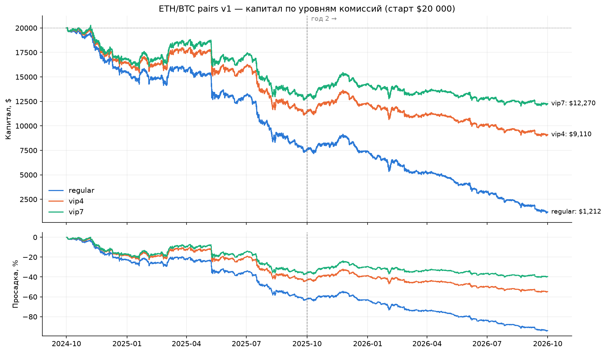

# Pairs Trading Backtest: ETHUSDT / BTCUSDT

Statistical arbitrage (pairs trading) backtest on Binance USDⓈ-M perpetual futures,
written from scratch in Python (polars, numpy).

## 1. Summary
- Built a full pipeline from scratch: data download and validation, 5m bars, a z-score pairs signal, an event-driven backtest engine with per-leg fees, metrics, and position export in the team's format. 24 tests pass, including no look-ahead and a hand-checked trade.
- v1 loses money at every fee tier (Regular −94%, VIP-4 −54%, VIP-7 −39% over two years). Before costs the signal earns ≈ +1.2 bp of turnover, while costs are 3.2–6 bp per fill.
- Mean reversion itself works: exits on z → 0 are profitable even after Regular fees. The losses come from trades where the spread trends instead of reverting (stops and time stops). This points to clear next steps.

## 2. Strategy
- **Spread:** `s = ln(ETH) − β·ln(BTC)` (v1: β = 1)
- **Signal:** z-score of the spread over a rolling 1-day window (288 × 5m candles, current candle included)
- **Entry:** z > 2 → short spread (sell ETH, buy BTC); z < −2 → long spread (buy ETH, sell BTC). $10,000 per leg
- **Exit:** z crosses 0
- **Stops:** |z| > 4 (stop-loss), or position held for 576 candles = 2 days (time stop)
- **After a stop or time stop:** no new entries until |z| < 2
- **One position at a time**
- **End of data:** an open position is closed at the last candle's close (reason `end`)

| # | Rule |
|---|---|
| 1 | Entry: \|z\| > 2, $10,000 per leg, BTC leg always opposite to ETH |
| 2 | Exit: z crosses 0 |
| 3 | Stop-loss: \|z\| > 4 |
| 4 | Time stop: 576 candles (2 days) |
| 5 | After stop / time stop: pause until \|z\| < 2 |
| 6 | One position at a time |
| 7 | Decide on close[t], execute on open[t+1] |
| 8 | No execution on candles where either leg had no trades (`n_traded = 0`) |
| 9 | Fees + slippage on every fill (4 fills per round trip) |

## 3. Data
- **Source:** [data.binance.vision](https://data.binance.vision): monthly 1m klines and funding rates
- **Instruments:** ETHUSDT, BTCUSDT (USDⓈ-M perpetual futures)
- **Period:** 2024-10-01 – 2026-09-30 (24 months)
- **Timeframes:** 1m downloaded; 5m built from 1m (main timeframe)
- **Quality check (1m):** 1,051,200 bars per symbol, 0 duplicates, 0 gaps, 0 invalid OHLC bars
- **No-trade periods:** 127 (ETH) / 126 (BTC) zero-volume minutes in 7–8 episodes at the same timestamps
  for both symbols (exchange-wide halts; longest 74 min on 2024-10-28). Prices there are carried forward,
  so 5m open/high/low use only traded minutes, and `n_traded` marks incomplete bars.
- **5m validation:** 5m bars built from 1m match Binance's own 5m file for 2024-10 on all 8,928 bars.
- **Output:** `data/processed/pair_1m.parquet` (1,051,200 rows), `pair_5m.parquet` (210,240 rows)
- **Split:** year 1 (2024-10 – 2025-09) for parameter selection, year 2 (2025-10 – 2026-09) out-of-sample

## 4. Backtest assumptions
- Signal on candle close, execution at the next candle's open (no look-ahead; verified by a test)
- Market orders only → taker fees
- Fee tiers tested: Regular (5 bp), VIP-4 (3 bp), VIP-7 (2.2 bp)
- Slippage: 1 bp per fill
- No trading on bars where either symbol had no trades (`n_traded = 0`); the pending order waits for the next tradable bar
- Funding: not included in v1 (planned next)
- Capital: $20,000 at start; fixed $10,000 per leg on every trade, no reinvestment
- Accounting: `equity = cash + qty_ETH · close_ETH + qty_BTC · close_BTC` on every candle

## 5. Results
v1 parameters were fixed before running; nothing has been tuned yet.



| | Regular | VIP-4 | VIP-7 |
|---|---|---|---|
| Final equity | $1,212 | $9,110 | $12,270 |
| Total return | −94% | −54% | −39% |
| Max drawdown | −94% | −56% | −41% |
| Sharpe (daily, ×√365) | −3.2 | −1.7 | −1.2 |
| Trades | 987 | 987 | 987 |
| Win rate | 56% | 60% | 61% |
| Avg trade | −$19.04 | −$11.03 | −$7.83 |
| Avg win / avg loss | +$58 / −$116 | +$62 / −$121 | +$63 / −$122 |
| Profit factor | 0.63 | 0.77 | 0.83 |
| Exposure | 54% | 54% | 54% |

469 short / 518 long trades. Exits: 778 mean, 201 stop, 8 time, 0 end.

**By exit reason (Regular)**

| Exit | Trades | Avg PnL | Total |
|---|---|---|---|
| mean (z crossed 0) | 778 | +$17.68 | +$13,754 |
| stop (\|z\| > 4) | 201 | −$131 | −$26,418 |
| time (2 days) | 8 | −$765 | −$6,124 |

**Worst trades (Regular).** 4 of the 5 worst trades are time stops: −$1,920 (May 2025), −$1,231 (Jul 2025),
−$864 (Aug 2025) and −$785 (Jan 2026). They match the steps in the equity curve. During a trend the rolling
mean follows the spread, so z stays at 2–3: the z-stop never fires while the loss keeps growing.
The worst stop was −$516 within 10 minutes, during a sharp market move.

**Takeaways**
- Mean reversion itself works: exits on z → 0 earn +$17.68 per trade even after Regular fees.
- Losses come from trades where the spread trends instead of reverting.
- The average loss is about 2× the average win; break-even would need a ~67% win rate (actual 56–61%).

## 6. Costs and fee sensitivity

| Tier | Taker + slippage | Per fill ($10k) | Round trip (4 fills) |
|---|---|---|---|
| Regular | 5 + 1 = 6 bp | $6.00 | $24.00 |
| VIP-4 | 3 + 1 = 4 bp | $4.00 | $16.00 |
| VIP-7 | 2.2 + 1 = 3.2 bp | $3.20 | $12.80 |

**Edge per turnover.** Turnover ≈ 987 trades × 4 fills × $10k ≈ $39.5M on $20k of capital.

| Tier | Signal (before costs) | Costs | Net |
|---|---|---|---|
| Regular | +1.2 bp | −6 bp | −4.8 bp |
| VIP-4 | +1.2 bp | −4 bp | −2.8 bp |
| VIP-7 | +1.2 bp | −3.2 bp | −2.0 bp |

Breaking even at Regular would need > 6 bp per fill (~5× the current edge): fewer trades with larger moves per trade.

**Engine consistency check.** The trades are identical across tiers, so the differences between tiers come from fees only:
the final-equity gap equals 987 × the fee difference (±$2), and the avg trade differs by exactly $8.00 and $3.20.

## 7. Robustness

**Year 1 vs year 2 (Regular)**

| | Year 1 | Year 2 |
|---|---|---|
| Trades | 483 | 504 |
| PnL | −$12,424 | −$6,364 |
| Avg trade (before costs ≈ avg + $24) | −$25.7 (≈ $0) | −$12.6 (≈ +$11) |
| Win rate | 58% | 53% |
| Avg win / avg loss | +$70 / −$158 | +$46 / −$80 |
| Stops | 92 | 109 |

- In year 1 the spread trended (ETH weakened against BTC), so deviations did not revert and losses were larger.
  In the calmer year 2 the signal earns ≈ +$11 per trade before costs, and VIP-7 is close to flat for the year (≈ −$500).
- My prediction before the run was that year 2 would have a smaller edge per trade. It turned out the other way.
- Not done yet: parameter robustness (sub-periods of year 1, walk-forward, looking for plateaus rather than peaks).
  From now on all changes are decided on year 1 only; year 2 is kept for one final check.

**Correctness tests (24, `pytest`)**
- Data: 5m step and no duplicates, valid OHLC, resampling, no-trade minutes ignored
- Signals: spread formula and β, NaN warm-up, hand-computed z (3/√7), **no look-ahead** (z on 1,500 vs 2,000 bars), which fails if a centered window is introduced
- Costs: per fill for each tier, round trip
- Engine: entry/exit rules and boundaries (`>` vs `>=`, 575 vs 576), position sizing and PnL sign,
  **one hand-checked trade** (equity on every candle, PnL 176.12), halt delays entry, close at end of data
- Metrics: return, drawdown, Sharpe, trade stats
- Export: format, row count, positions per leg

## 8. Limitations
- **Candles only:** no order queue, book depth or partial fills. Fills are assumed at the next candle's open plus a flat 1 bp slippage.
- **Fixed size:** $10,000 per leg regardless of equity, so effective leverage grows as equity falls (≈16× at the end of the Regular run). This isolates the per-trade edge, but it is not realistic sizing.
- **Stops on z only:** no stop based on the loss from the entry price, which is what caused the large time-stop losses.
- **No funding** in v1.
- **Stops checked once per 5m bar:** fast moves inside a bar are not caught.

## 9. How to run
```bash
conda create -n quant python=3.13 -y
conda activate quant
pip install -r requirements.txt
python -m src.download      # download and verify all data (~97 files)
python -m src.prepare       # check, align and resample → data/processed/*.parquet
pytest -v                   # 24 tests
```
Then open `notebooks/02_first_backtest.ipynb` → Run All (backtest on 3 fee tiers, metrics, charts, position export).

**Output for the team:** `reports/positions_v1.parquet` with columns `symbol, timestamp, position_qty, close_price`,
two rows per 5-minute candle (ETHUSDT, BTCUSDT), 420,480 rows. `timestamp` is the candle open time (UTC);
`position_qty` is the position held during that candle after execution at its open (+ long, − short).
Positions are identical for all fee tiers.

**Project structure**
```
config.py              paths, symbols, fees, strategy parameters
src/download.py        download + checksum Binance data
src/prepare.py         build 1m / 5m aligned pair datasets
src/signals.py         log spread, rolling z-score
src/costs.py           fee + slippage per fill
src/engine.py          entry/exit rules, position sizing, backtest loop
src/metrics.py         return, drawdown, Sharpe, trade stats, exposure
src/export.py          positions in the team's format
notebooks/01_data_check.ipynb      data and spread analysis
notebooks/02_first_backtest.ipynb  v1 backtest, fee tiers, metrics, charts, export
tests/                 pytest tests
```

## 10. Next steps
1. Funding.
2. Numba for the backtest loop (fast parameter scans).
3. Improvements, one at a time, chosen on year 1 only:
   - stop based on the loss from the entry price (not only on z)
   - shorter time stop
   - regime filter (skip entries while the spread is trending)
   - entry threshold and window length (fewer trades, larger move per trade)
   - β by regression (then rolling / Kalman)
   - equity-based position sizing
4. One final out-of-sample check on year 2.

## 11. Use of LLM
Design choices and debugging were discussed with an LLM; all code was written by me.